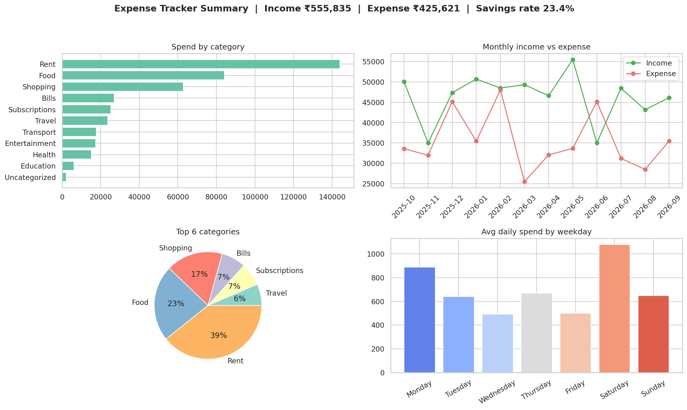
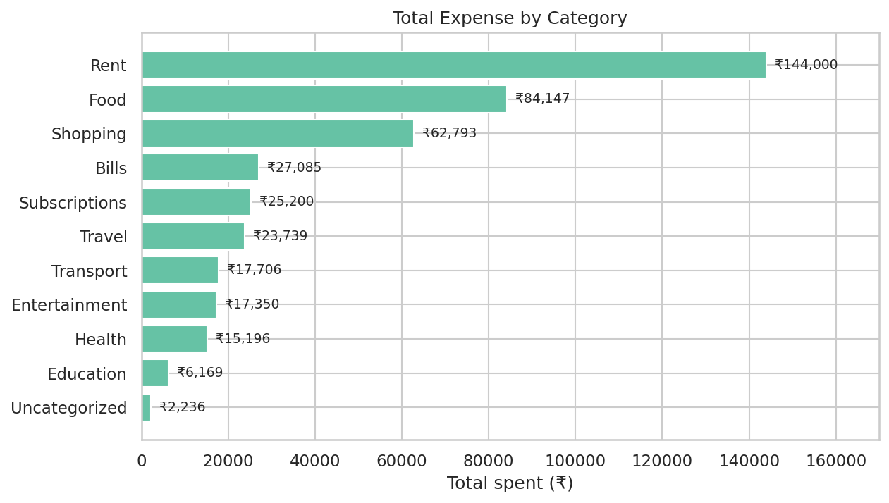
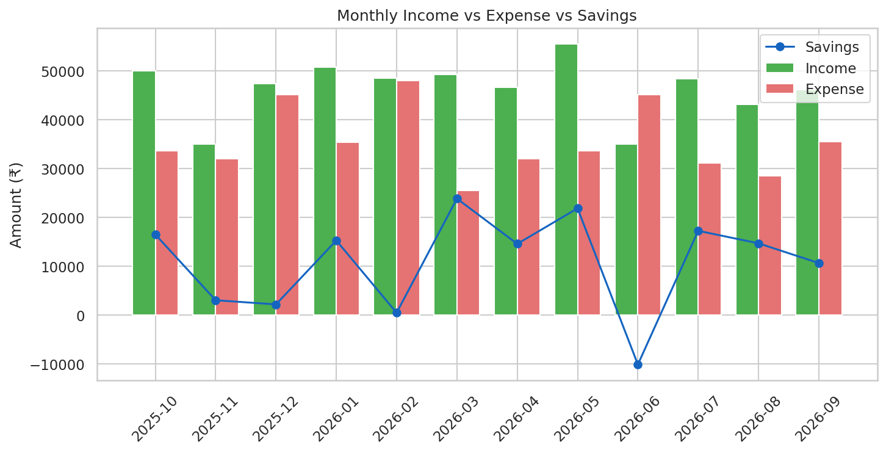
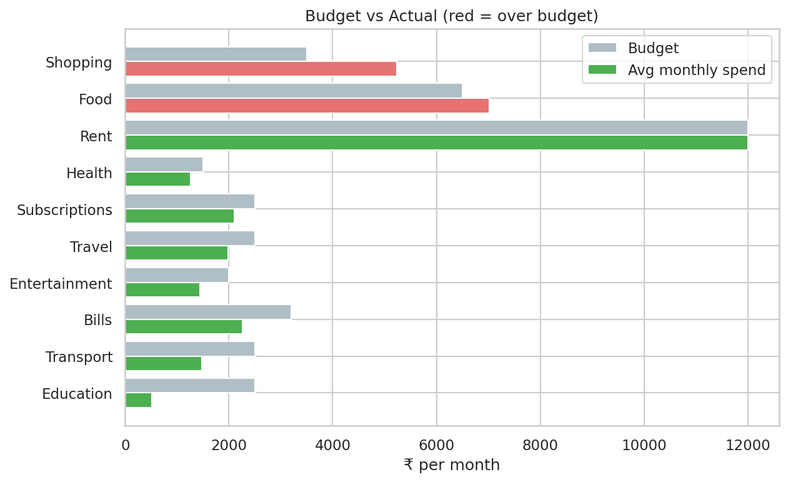
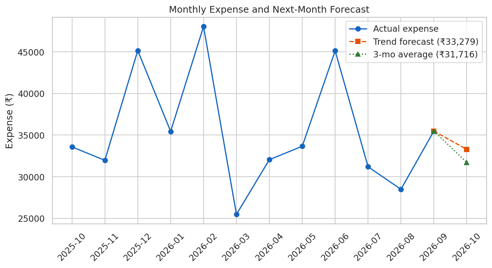
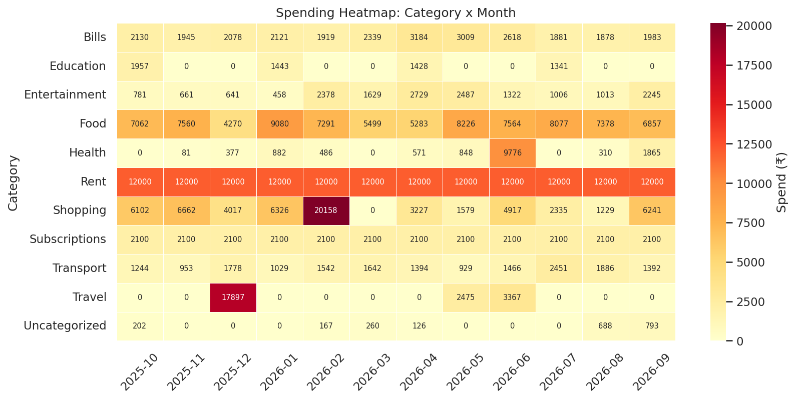
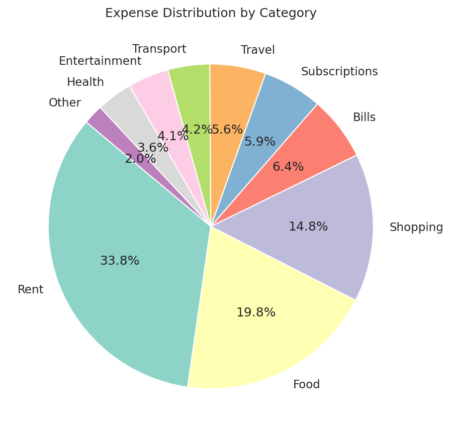

# 💰 Expense Tracker App using Data Science

An end-to-end data science project that turns messy transaction data into **spending summaries, budget alerts, anomaly detection, a next-month forecast and an interactive dashboard** - built entirely in Python with free tools and **synthetic data** (no real bank data needed).



## 📌 Overview
Everyone from students to startups needs to know *where the money goes*. Raw bank exports and receipts are hard to read, so this project builds the full pipeline an analyst would: **data input → cleaning → analysis → visualization → insights → decisions.**

## ❗ Problem
- Transaction logs are messy (duplicates, blanks, inconsistent categories, "₹1,200" stored as text).
- People overspend without noticing which category or month is the problem.
- Static Excel sheets do not warn you early or predict upcoming spend.

## ✅ Solution
A reproducible Python pipeline + Streamlit dashboard that:
1. Generates a realistic 12-month **synthetic** dataset (or accepts your own CSV / manual entries).
2. Cleans and standardises it, and engineers time features.
3. Analyses category, monthly, weekday and payment-method behaviour.
4. Compares spending with **budgets** and raises **overspending alerts**.
5. Detects **unusually large expenses** (IQR rule) and **forecasts next month's spend**.
6. Writes a plain-English insights report - optionally enhanced by a **local LLM (Ollama)**, free and private.

## ✨ Features
| Area | What it does |
|---|---|
| Data generation | Seeded synthetic data with seasonality, weekend effects, fixed bills, one-off big purchases, income + freelance income |
| Cleaning | Duplicates, missing values, ₹/comma amounts, text casing, payment-method fixes, date features |
| Analysis | KPIs, savings rate, category share, month-on-month change, weekday habits, payment mix |
| Budgeting | Monthly budget per category, breach alerts, budget-vs-actual |
| AI layer | Anomaly detection, trend + moving-average forecast, optional Ollama advice |
| Dashboard | Filters, add-a-transaction form, 5 tabs, CSV download |
| Quality | 5 unit tests (`pytest`), verified on pandas 2.x and 3.x |

## 🧰 Tech Stack
Python · pandas · NumPy · Matplotlib · Seaborn · Plotly · Streamlit · pytest · (optional) Ollama

## 📂 Project Structure
```
Expense-Tracker-App/
├── data/                # raw_expenses.csv (synthetic, messy) and cleaned_expenses.csv
├── notebooks/           # step-by-step walkthrough notebook
├── src/                 # config, generate_data, clean_data, analysis, visualize, insights
├── outputs/             # CSV reports + insights_report.md
├── images/              # generated charts (used in this README)
├── tests/               # pytest unit tests
├── docs/                # full project guide
├── hardware/            # optional ESP32 button logger
├── app.py               # Streamlit dashboard
├── main.py              # runs the whole pipeline
└── requirements.txt
```

## ▶️ How to Run
```bash
# 1. clone and enter
git clone https://github.com/<your-username>/Expense-Tracker-App-Data-Science.git
cd Expense-Tracker-App-Data-Science

# 2. virtual environment
python -m venv .venv
.venv\Scripts\activate            # Windows
source .venv/bin/activate         # Mac / Linux

# 3. install
pip install -r requirements.txt

# 4. run the pipeline (creates data, charts, reports)
python main.py

# 5. launch the dashboard
streamlit run app.py

# optional: tests and local-AI advice
pytest -q
python main.py --ai        # needs Ollama running (ollama pull llama3.2)
```

## 📊 Results (synthetic dataset, Oct 2025 - Sep 2026)
- **715** clean transactions after removing 10 duplicates and 7 invalid rows
- Income **₹5,55,835** · Expense **₹4,25,621** · Savings rate **23.4%**
- Rent is the largest cost (33.8%), **Food** is the biggest flexible category (19.8%) and breaches its budget in 9 of 12 months
- Saturday has the highest average daily spend (about ₹1,076/day) and Wednesday the lowest
- Expenses exceeded income in 1 month (June 2026: a trip plus a one-off ₹9,000 health expense, with no freelance income that month)
- 4 unusual expenses flagged; next-month forecast about ₹31.7k-₹33.3k

## 🖼️ Screenshots
| Category spend | Monthly trend |
|---|---|
|  |  |
| **Budget vs actual** | **Forecast** |
|  |  |
| **Heatmap** | **Expense distribution** |
|  |  |

Add your own dashboard screenshots to `images/` (for example `dashboard_overview.png`) after running `streamlit run app.py`.

## 🔮 Future Improvements
Mobile app (Streamlit → Flutter / React Native), real-time tracking (UPI SMS parsing or ESP32 buttons), ML forecasting (Prophet / ARIMA), automatic category prediction from descriptions, Telegram budget alerts via n8n, goal tracking, multi-user login.

## ⚠️ Note on data
All data is **synthetic** and generated with a fixed random seed, so results are reproducible. Real data can be dropped in as `data/raw_expenses.csv` with columns `Date, Category, Description, Amount, Type, Payment_Method`.

## 👤 Author
Jatin - student data analytics / AI builder. License: MIT.
